<p align="center">
  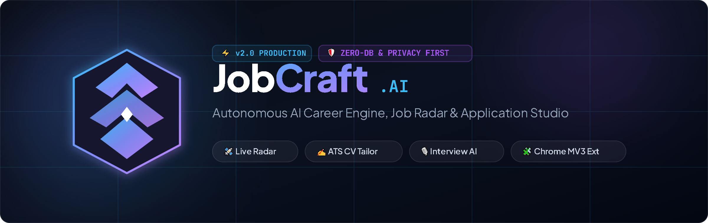
</p>

<p align="center">
  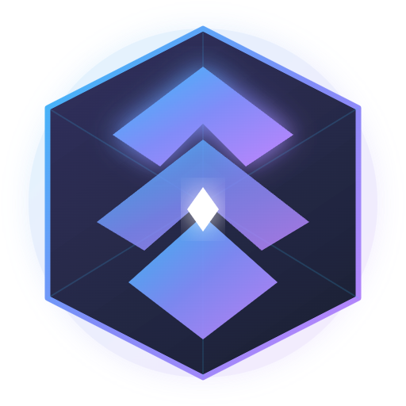
</p>

<h1 align="center">JobCraft AI</h1>

<p align="center">
  <strong>The Autonomous AI Career Engine, Real-time Job Radar &amp; Application Studio.</strong><br>
  <em>Stop sending resumes into a black hole. Craft your career advancement with precision automation.</em>
</p>

<p align="center">
  <a href="#-highlights--feature-matrix"></a>
  <a href="LICENSE"></a>
  <a href="https://nodejs.org/"></a>
  <a href="https://aistudio.google.com/"></a>
  <a href="#-chrome-extension-installation"></a>
  <a href="#️-privacy--zero-database-architecture"></a>
  <a href="#-cloud--container-deployment"></a>
</p>

---

## ⚡ What is JobCraft?

Job hunting shouldn't feel like sending resumes into a black hole. **JobCraft** transforms the chaotic job search into an automated, data-driven craft.

With **zero external database dependencies**, JobCraft combines an ultra-fast glassmorphic web studio, a companion Manifest V3 Chrome extension, real-time multi-portal scrapers, and a Google Gemini intelligence pool to discover, evaluate, tailor, and prepare you for your dream roles in seconds.

Everything runs **100% locally and privately** on your machine or private container.

---

## 📑 Table of Contents

- [🌟 Highlights & Feature Matrix](#-highlights--feature-matrix)
- [📊 Feature Comparison: JobCraft vs Alternatives](#-feature-comparison-jobcraft-vs-alternatives)
- [🏛️ System Architecture](#️-system-architecture)
- [🔄 End-to-End Application Workflow](#-end-to-end-application-workflow)
- [✨ Visual Feature Walkthrough](#-visual-feature-walkthrough)
  - [1. Real-time Job Radar & Multi-Portal Aggregator](#1-real-time-job-radar--multi-portal-aggregator)
  - [2. Deep Fit Analyzer & Gap Scoring](#2-deep-fit-analyzer--gap-scoring)
  - [3. 1-Page ATS Resume & Cover Letter Studio](#3-1-page-ats-resume--cover-letter-studio)
  - [4. AI Mock Interview Simulator & Coach](#4-ai-mock-interview-simulator--coach)
  - [5. Upskill Hub & Learning Milestones](#5-upskill-hub--learning-milestones)
  - [6. Application Pipeline Kanban Tracker](#6-application-pipeline-kanban-tracker)
  - [7. Manifest V3 Chrome Companion Extension](#7-manifest-v3-chrome-companion-extension)
  - [8. Founder Admin Dashboard & HWID Vault](#8-founder-admin-dashboard--hwid-vault)
- [🚀 Quick Start (Local Development)](#-quick-start-local-development)
- [🧩 Chrome Extension Installation](#-chrome-extension-installation)
- [🌐 Cloud & Container Deployment](#-cloud--container-deployment)
  - [Deploy on Render (Free 24/7)](#deploy-on-render-free-247)
  - [Deploy with Docker](#deploy-with-docker)
  - [Deploy on Linux VPS (PM2 & Nginx)](#deploy-on-linux-vps-pm2--nginx)
- [⚙️ Environment Configuration (.env)](#️-environment-configuration-env)
- [📁 Repository Structure](#-repository-structure)
- [🛡️ Privacy & Zero-Database Architecture](#️-privacy--zero-database-architecture)
- [🤝 Contributing](#-contributing)
- [📄 License](#-license)

---

## 🌟 Highlights & Feature Matrix

| Capability | Description | Status |
| :--- | :--- | :---: |
| 🛰️ **Live Job Radar** | Multi-portal real-time scraping across LinkedIn, FreeHire, JobIndex, Jobnet without rate limits. | ✅ Active |
| 🎯 **AI Fit Analyzer** | Quantitative match % (0–100%), skill radar, missing skills & tailored recommendations. | ✅ Active |
| ✍️ **1-Page ATS Tailor** | Generates ATS-optimized resumes (LaTeX & Markdown) and targeted cover letters in seconds. | ✅ Active |
| 🎙️ **Interview Coach** | Dynamic role-specific mock interview generator with follow-up challenges and scoring. | ✅ Active |
| 🧭 **Upskill Roadmaps** | Bridges technical skill gaps with automated, step-by-step learning milestones. | ✅ Active |
| 📌 **Pipeline Tracker** | Built-in application tracker with CSV export and stage indicators. | ✅ Active |
| 🧩 **Chrome Extension** | Companion Manifest V3 sidepanel that extracts active job listings with 1-click sync. | ✅ Active |
| 🛡️ **HWID Device Vault** | Hardware fingerprinting, brute-force IP throttling, and zero external DB required. | ✅ Active |
| 📊 **Admin Analytics** | Founder analytics dashboard with live revenue counter, active devices, and CSV audit. | ✅ Active |
| ⚡ **Cloud Keep-Alive** | Built-in heartbeat self-ping prevents free cloud instances (Render) from sleeping. | ✅ Active |

---

## 📊 Feature Comparison: JobCraft vs Alternatives

| Feature | JobCraft | Manual Search | Simplify / Teal | LazyApply |
| :--- | :---: | :---: | :---: | :---: |
| **Privacy First (Local-First)** | ✅ **100% Local** | ✅ N/A | ❌ Cloud Stored | ❌ Cloud Stored |
| **External Database Required** | ❌ **Zero (Atomic JSON)** | ❌ None | ⚠️ Postgres/Mongo | ⚠️ SQL Server |
| **Real-time LinkedIn Radar** | ✅ **Built-in** | ❌ Manual browsing | ⚠️ Limited | ⚠️ Bot scrapers |
| **LaTeX & Markdown ATS Export** | ✅ **Both Supported** | ❌ Manual editing | ⚠️ PDF only | ❌ Templated |
| **Interactive AI Interview Coach** | ✅ **Included** | ❌ None | ❌ None | ❌ None |
| **Chrome Manifest V3 Sidepanel** | ✅ **Included** | ❌ None | ⚠️ Form-fill only | ⚠️ Auto-clicker |
| **Upskill Bridge Roadmaps** | ✅ **Automated** | ❌ Manual research | ❌ None | ❌ None |
| **Device-Locked License Vault** | ✅ **HWID Fingerprint** | ❌ None | ❌ Closed SaaS | ❌ Closed SaaS |

---

## 🏛️ System Architecture

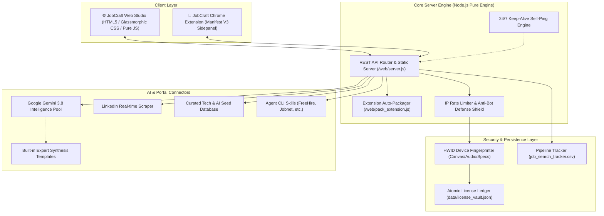

---

## 🔄 End-to-End Application Workflow

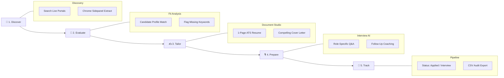

---

## ✨ Visual Feature Walkthrough

### 1. Real-time Job Radar & Multi-Portal Aggregator
- Live querying against LinkedIn public job endpoints and curated multi-portal opportunities without rate limits.
- Instant search filters for title, location, seniority level, and contract type.
- Built-in salary benchmark tags and instant 1-click inspection.

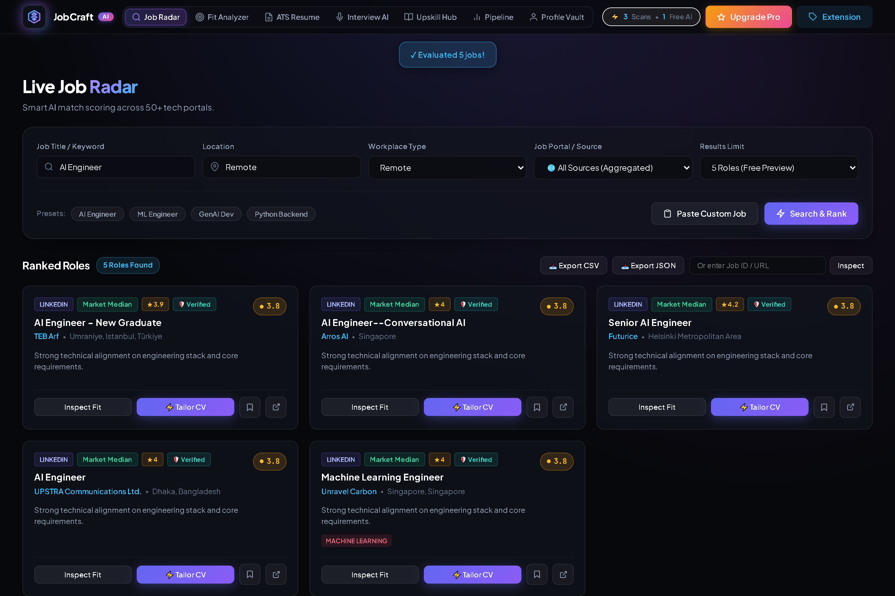

---

### 2. Deep Fit Analyzer & Gap Scoring
- Evaluates candidate experience against raw job descriptions.
- Computes quantitative fit percentage (0–100%), highlighting key strengths, critical missing skills, and deal-breaker flags.
- Actionable recommendations on how to frame past achievements for maximum recruiter interest.

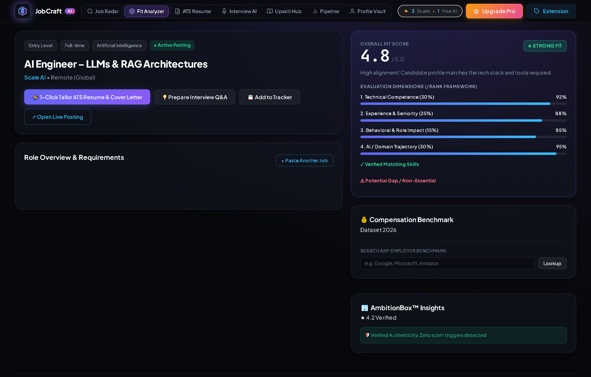

---

### 3. 1-Page ATS Resume & Cover Letter Studio
- Instant 1-page ATS-formatted resume generated to match the exact keywords and skills of target employers.
- Story-driven, personalized cover letters highlighting production-grade metrics.
- Export options include clean **Markdown** for instant copying and **LaTeX** for precision compilation.

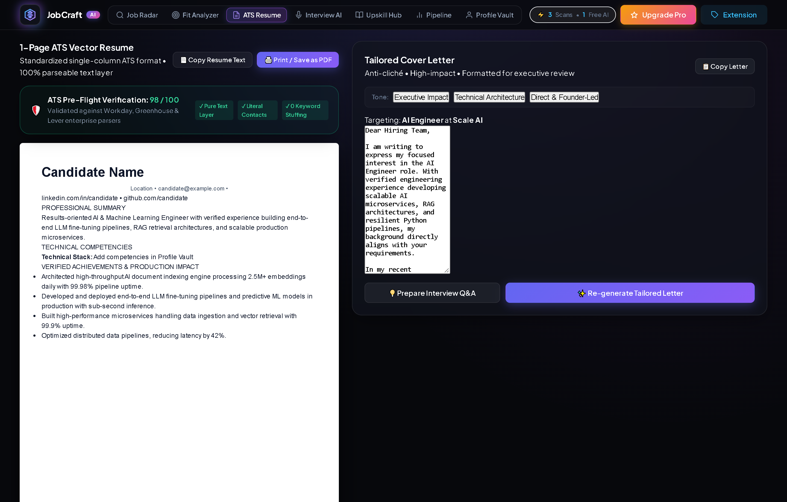

---

### 4. AI Mock Interview Simulator & Coach
- Dynamic technical and behavioral interview preparation customized to the company and role.
- Generates realistic screening questions, architectural drilldowns, and optimal talking points.
- Instant feedback coach highlights missing STAR method elements.

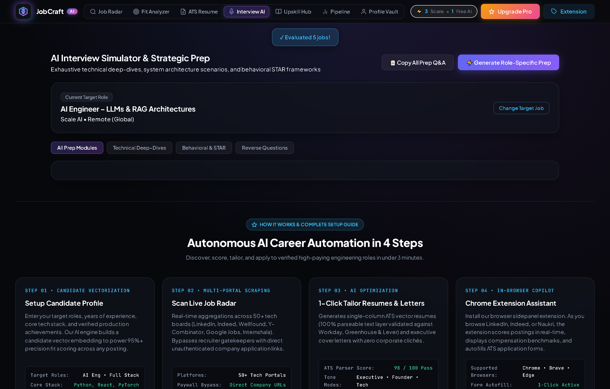

---

### 5. Upskill Hub & Learning Milestones
- Automatically bridges technical gaps between your profile and target positions.
- Generates targeted, week-by-week learning roadmaps for missing technologies, tools, and certifications.

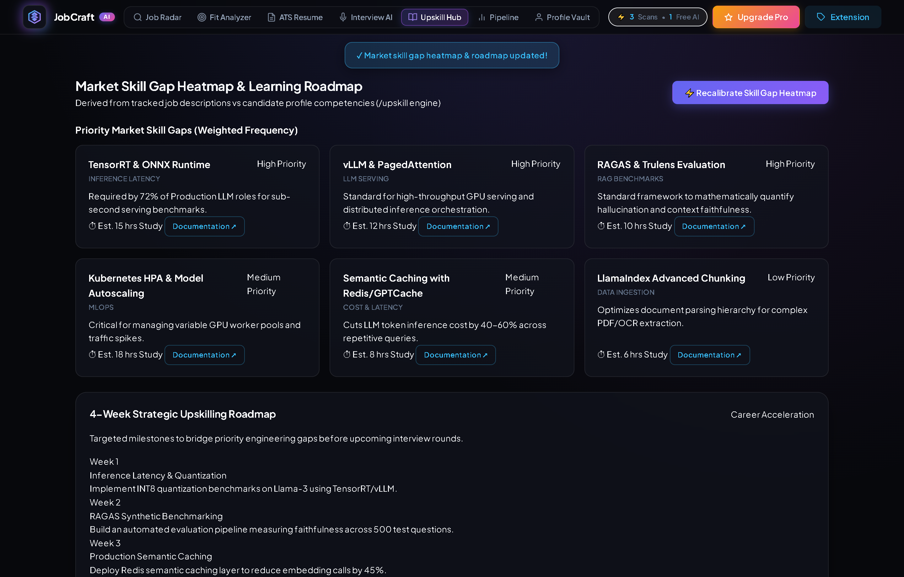

---

### 6. Application Pipeline Kanban Tracker
- Centralized tracking for all active applications across multiple stages: *Applied*, *Screening*, *Interview*, *Offer*.
- Full CSV export and atomic persistence into `job_search_tracker.csv`.

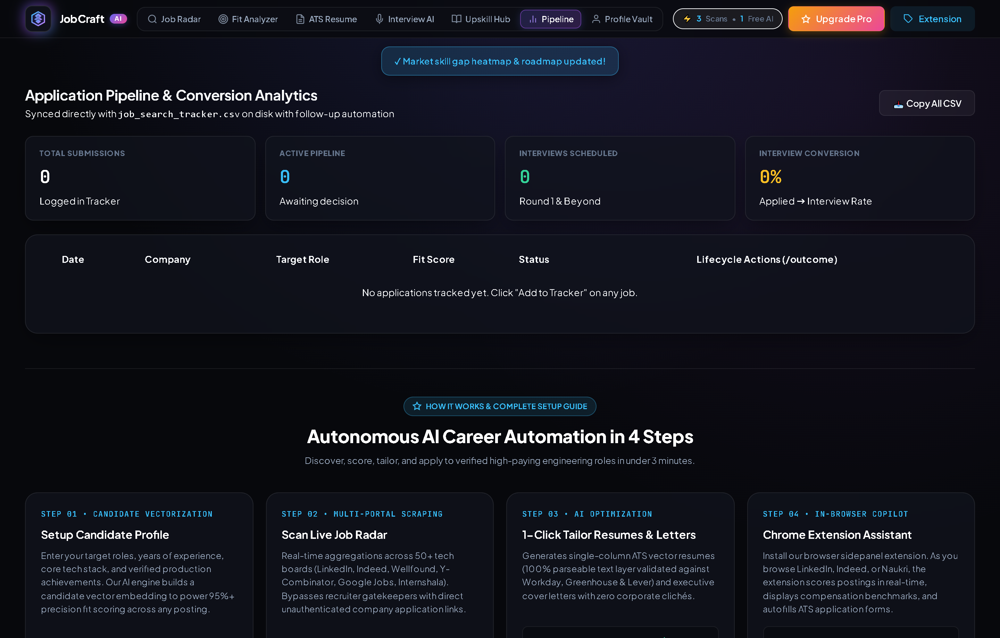

---

### 7. Manifest V3 Chrome Companion Extension
- Compact, lightweight sidepanel living directly in your Chrome browser.
- Automatically inspects LinkedIn job postings with 1 click and seamlessly syncs with your Web Studio.
- Auto-packaged on server startup with zero external build tools required.

<p align="center">
  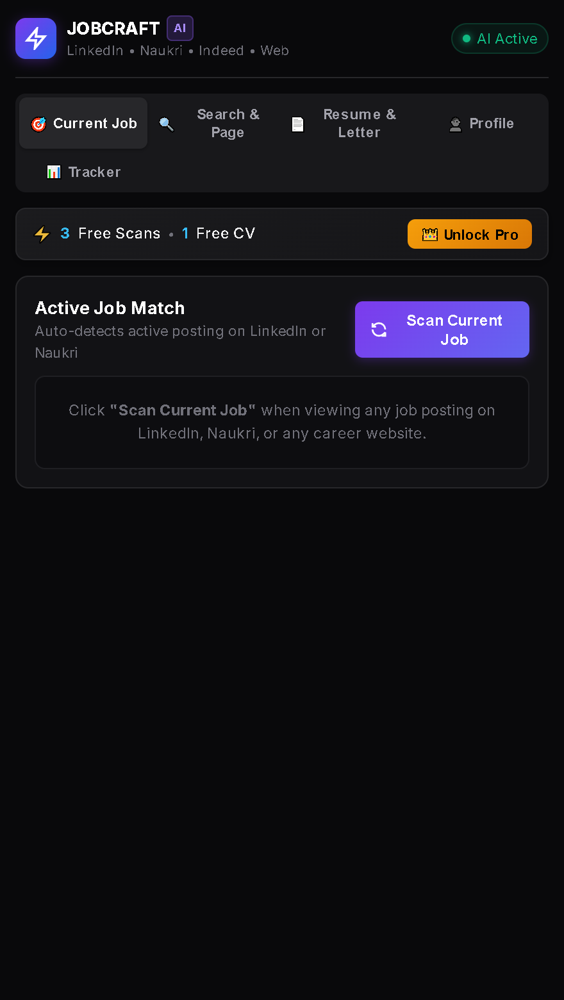
</p>

---

### 8. Founder Admin Dashboard & HWID Vault
- Protected master founder console accessible at `/admin.html`.
- Real-time revenue counter, device ID seat allocations, license generation, and 1-click CSV ledger export.
- Atomic file writes prevent JSON ledger corruption even under sudden server restarts.

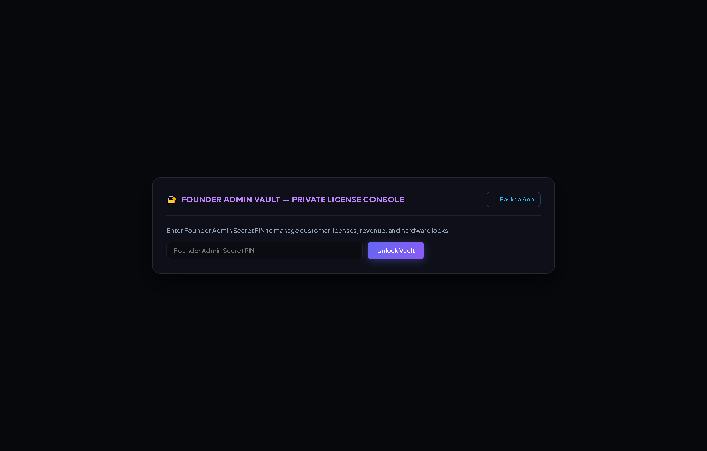

---

## 🚀 Quick Start (Local Development)

### Prerequisites
- **Node.js**: `v18.0.0` or higher
- **Git** installed on your system
- *(Optional)* Free Google Gemini API Key from [Google AI Studio](https://aistudio.google.com/)

### 1. Clone the repository
```bash
git clone https://github.com/<your-username>/JobCraft.git
cd JobCraft
```

### 2. Configure Environment Variables
Copy the example environment configuration:
```bash
cp .env.example .env
```
*(On Windows PowerShell: `Copy-Item .env.example .env`)*

### 3. Start the Server
JobCraft has **zero external runtime dependencies**! Simply run:
```bash
npm start
```
*Or directly via Node:*
```bash
node web/server.js
```

### 4. Open in Browser
Navigate to:
```
http://localhost:3000
```
- **Web Studio**: `http://localhost:3000`
- **Founder Admin**: `http://localhost:3000/admin.html`
- **Health Endpoint**: `http://localhost:3000/api/health`

---

## 🧩 Chrome Extension Installation

You can run the companion Chrome extension directly alongside the Web Studio:

```
┌────────────────────────────────────────────────────────┐
│  1. Open http://localhost:3000                         │
│  2. Click "🧩 Extension" in top navbar (or download)   │
│  3. Unzip ai-job-copilot-extension.zip                 │
│  4. In Chrome, navigate to chrome://extensions          │
│  5. Enable "Developer mode" (top-right toggle)         │
│  6. Click "Load unpacked" and select the extension/ dir│
└────────────────────────────────────────────────────────┘
```

Once installed, pin the extension. When browsing any job on LinkedIn, open the sidepanel to instantly analyze the job posting against your profile!

---

## 🌐 Cloud & Container Deployment

### Deploy on Render (Free 24/7)

The repository includes a ready-to-use [`render.yaml`](render.yaml) blueprint:

1. Push this repo to GitHub.
2. Sign in to [Render](https://render.com) and create a **New Blueprint** connecting this repo.
3. Configure your Environment Variables:
   - `PORT`: `10000`
   - `ADMIN_SECRET`: Your secure custom admin passphrase
   - `GEMINI_API_KEYS`: Optional Gemini API key(s)
4. Click **Apply**! The built-in heartbeat self-ping keeps free instances running 24/7 without cold starts.

---

### Deploy with Docker

A production-ready multi-stage [`Dockerfile`](Dockerfile) is included:

```bash
# 1. Build the Docker image
docker build -t jobcraft:latest .

# 2. Run the container
docker run -d -p 3000:3000 \
  -e ADMIN_SECRET="your_secure_secret" \
  -e GEMINI_API_KEYS="your_gemini_key" \
  --name jobcraft-app \
  jobcraft:latest

# 3. View logs
docker logs -f jobcraft-app
```

---

### Deploy on Linux VPS (PM2 & Nginx)

For standard VPS deployments (Ubuntu / Debian / DigitalOcean / AWS):

```bash
# 1. Clone repository
git clone https://github.com/<your-username>/JobCraft.git
cd JobCraft
cp .env.example .env

# 2. Start daemon with PM2
sudo npm install -g pm2
pm2 start web/server.js --name "jobcraft"
pm2 save
pm2 startup
```

*(Production Nginx & Caddy templates are included in [`deploy/`](deploy/)).*

---

## ⚙️ Environment Configuration (.env)

| Variable | Required | Default | Description |
| :--- | :---: | :--- | :--- |
| `PORT` | Optional | `3000` | HTTP port for the web server |
| `NODE_ENV` | Optional | `production` | Environment mode (`production` / `development`) |
| `APP_URL` | Optional | `http://localhost:3000` | Base URL used for 24/7 heartbeat keep-alive self-ping |
| `GEMINI_API_KEYS` | Optional | *(Built-in Fallback)* | Comma-separated Gemini API keys for automatic rotation |
| `GEMINI_API_KEY` | Optional | *(Built-in Fallback)* | Single Gemini API key fallback |
| `ADMIN_SECRET` | Recommended | Custom passphrase | Secret passphrase to unlock `/admin.html` dashboard |
| `VAULT_SECRET_SALT` | Recommended | Random String | Cryptographic salt used for hardware device fingerprint hashing |
| `MERCHANT_NAME` | Optional | `JobCraft Studio` | Merchant branding displayed in payment confirmation modals |

---

## 📁 Repository Structure

```
JobCraft/
├── .agents/                    # Agentic CLI search skills (FreeHire, Jobnet, JobIndex)
├── assets/                     # Visual assets & documentation media
│   ├── hero-banner.png         # High-resolution retina header banner
│   ├── logo.png                # Transparent JobCraft falcon emblem logo
│   └── screenshots/            # 8 retina screenshots of live application views
├── deploy/                     # Production deployment templates (Nginx, Caddy)
│   ├── nginx.conf              # Production Nginx reverse proxy template
│   ├── Caddyfile               # Auto-HTTPS Caddy configuration
│   └── README.md               # Cloud and server deployment walkthrough
├── extension/                  # Chrome Companion Extension (Manifest V3)
│   ├── manifest.json           # Extension configuration & sidepanel declaration
│   ├── background.js           # Extension background service worker
│   ├── content.js              # DOM parser for active job postings
│   ├── sidepanel.html          # Interactive sidepanel UI
│   ├── sidepanel.js            # Sidepanel logic & synchronizer
│   └── icons/                  # Extension branding assets
├── web/                        # Web Studio & API Server
│   ├── server.js               # Production HTTP API & security engine
│   ├── pack_extension.js       # Zero-dependency in-memory extension packager
│   └── public/
│       ├── index.html          # High-performance glassmorphic studio interface
│       ├── app.js              # Client-side state, radar calculation & UI tabs
│       ├── style.css           # Modern CSS variable design system
│       ├── admin.html          # Founder analytics & license management console
│       └── logo.svg            # Web studio logo asset
├── data/
│   └── license_vault.json      # Atomic, self-healing HWID license ledger
├── cv/                         # LaTeX CV templates & output examples
├── cover_letters/              # LaTeX cover letter templates & font files
├── documents/                  # Candidate portfolio, diploma & application records
├── tools/                      # Verification scripts (PDF verification, salary, layout)
├── candidate_profile.json      # Candidate profile schema & preferences
├── job_search_tracker.csv      # Persistent application status ledger
├── render.yaml                 # 1-Click cloud deployment blueprint
├── Dockerfile                  # Production container blueprint
├── .env.example                # Environment variables reference template
├── .gitignore                  # Git privacy & secrets ignore patterns
├── LICENSE                     # MIT Open Source License
└── README.md                   # Project documentation
```

---

## 🛡️ Privacy & Zero-Database Architecture

1. **Local-First Candidate Privacy**: Your populated profile, resume history, and tracker CSV remain strictly local to your machine or private container. No personal data is transmitted to third-party telemetry servers.
2. **Zero External Database Dependency**: Operates with an atomic, backup-verified JSON ledger (`data/license_vault.json`), eliminating database leaks and connection pooling overhead.
3. **Hardware Fingerprint Protection**: Anti-sharing license validation uses multi-tier device fingerprinting (hardware concurrency, canvas rendering hash, screen color depth).
4. **Brute-Force & Rate-Limiting Shield**: Built-in IP rate limiter automatically temporarily locks abusive IPs attempting unauthorized vault modifications.
5. **Safe Secret Isolation**: All sensitive credentials (API keys, admin passwords, salts) are loaded strictly via environment variables (`.env`).

---

## 🤝 Contributing

Contributions, issues, and feature requests are welcome!

1. Fork the project.
2. Create your feature branch (`git checkout -b feature/AmazingFeature`).
3. Commit your changes (`git commit -m 'feat: Add some AmazingFeature'`).
4. Push to the branch (`git push origin feature/AmazingFeature`).
5. Open a Pull Request.

---

## 📄 License

Distributed under the **MIT License**. See [`LICENSE`](LICENSE) for more information.

<p align="center">
  Crafted with ❤️ for engineers, creators, and professionals seeking their dream roles.
</p>
